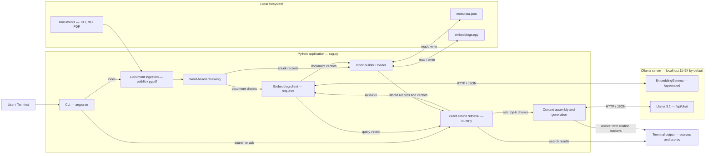
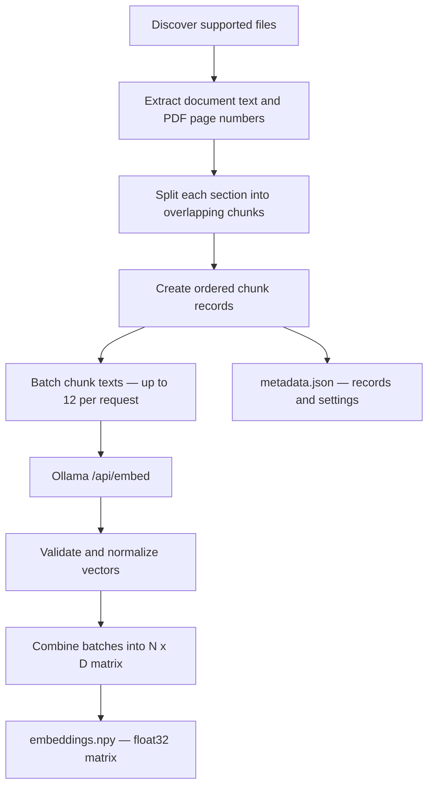
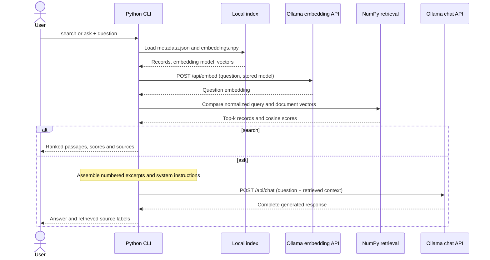

# Local Python RAG — from scratch

A minimal, real, **local** retrieval-augmented generation project. It implements document ingestion, overlapping chunks, embeddings, persistent local vectors, cosine-similarity search, context assembly, and LLM answering without LangChain, LlamaIndex, FAISS, Chroma, or API keys.

## Requirements

- Python 3.11 or newer
- Ollama installed and running locally: https://ollama.com/download
- Enough free RAM/storage to run two local models

Download the models (one time):

```bash
ollama pull embeddinggemma
ollama pull llama3.2
```

If Ollama is not already running, start it in another terminal with `ollama serve` (some desktop setups start the service automatically).

## Quick start (macOS / Linux)

```bash
git clone https://github.com/sinariazi/local_rag.git
cd local_rag
python3 -m venv .venv
source .venv/bin/activate
python -m pip install -r requirements.txt
python rag.py index --docs docs
python rag.py search "Who owns Project Atlas?"
python rag.py ask "Who owns Project Atlas?"
```

Windows PowerShell activation: `.venv\Scripts\Activate.ps1` (or use `.venv\Scripts\python.exe` to avoid activation).

## Add your own documents

Copy `.txt`, `.md`, or searchable (text-based) `.pdf` files into `docs/`, then rerun:

```bash
python rag.py index --docs docs
```

This rebuilds the index from all supported documents in the directory. The data is stored in `.rag_index/` as `metadata.json` (text, source, page) and `embeddings.npy` (numerical vectors).

Index a different directory:

```bash
python rag.py index --docs "/path/to/my/files" --index "./my_index"
python rag.py ask "Summarize the requirements" --index "./my_index" --top-k 5
```

Tune the word-based chunking:

```bash
python rag.py index --docs docs --chunk-size 180 --overlap 30
```

Use an alternative local Ollama chat model:

```bash
ollama pull gemma3:4b
python rag.py ask "Explain Atlas" --chat-model gemma3:4b
```

Changing the **embedding** model requires rebuilding the index; the query always uses the embedding model recorded in index metadata.

## Solution architecture

### Architecture overview

The system is a local-first, framework-free RAG application. It separates document indexing from query-time retrieval and generation. Python owns orchestration, document processing, persistence and ranking; Ollama serves the two AI models through HTTP. No external vector database, hosted LLM or model training is required.



### Component responsibilities

| Layer | Implementation | Responsibility |
| --- | --- | --- |
| Interface | `main()`, `make_parser()` / argparse | Accept `index`, `search` and `ask` commands and expose configuration. |
| Ingestion | `read_document_sections()` / pathlib, pypdf | Discover supported files recursively, extract text and preserve relative filenames and PDF page numbers. |
| Chunking | `split_into_chunks()` | Split sections into 220-word windows with 40-word overlap by default. |
| Model gateway | `ollama_post()` / requests | Centralize HTTP communication, connection/read timeouts and request error handling. |
| Embedding | `embed_texts()`, `normalize_rows()` | Batch up to 12 texts per request and produce normalized float32 vectors using the configured embedding model. |
| Persistence | `build_index()`, `load_index()` | Store and reload vectors, source records and index configuration using two local files. |
| Retrieval | `retrieve()`, `rank_documents()` / NumPy | Embed the query using the indexed model, calculate cosine similarities and return top-k chunks (default 4). |
| Generation | `generate_answer()`, `source_label()` | Build a grounded prompt with numbered sources and request a complete LLM response. |

### Indexing pipeline (document preparation)

Indexing runs explicitly when the user invokes `python rag.py index --docs docs`. It rebuilds the entire selected index rather than appending to it.



Each PDF page is processed as its own section. Markdown and TXT files are processed as whole-file sections. The chunking algorithm advances by `chunk_size - overlap` words (180 by default). Embedding requests disable silent truncation, so oversized inputs can fail rather than lose content unnoticed.

### Query-time pipeline



The search path does not invoke the generative model. This allows retrieval quality to be inspected independently of answer quality. The LLM receives the selected text passages, not the entire corpus or the vector matrix.

### Data architecture

The default index directory is `.rag_index/`:

| File | Data | Purpose |
| --- | --- | --- |
| `metadata.json` | Index version, embedding model, chunk size, overlap and ordered chunk records | Recover the text and provenance associated with each vector. |
| `embeddings.npy` | Two-dimensional NumPy float32 array with shape `(N, D)` | Store N chunk embeddings of dimension D for similarity search. |

The position of each vector row corresponds to the position of its chunk record. For example, row 0 represents record 0. There is no database-generated identifier or independent vector record.

Example chunk record (illustrative):

```json
{
  "source": "policy.pdf",
  "page": 2,
  "part": 1,
  "text": "Employees receive 25 days of annual leave."
}
```

`page` is `null` for TXT and Markdown documents. Chunk numbering starts at 1 within each extracted section. Source, page and part are used to construct human-readable references.

### Retrieval algorithm

Document and query vectors are normalized to unit length. The cosine similarity between vectors a and b is their dot product divided by the product of their magnitudes. Once normalized, their dot product alone gives cosine similarity.

```python
scores = vectors @ query_vector
top_indices = np.argsort(-scores)[:top_k]
```

The retrieval stage performs an exact scan across all N embeddings of dimension D. Scoring costs O(N × D), and the current full sorting step costs O(N log N). The raw float32 vector data takes approximately 4 × N × D bytes, excluding metadata and temporary arrays.

No approximate nearest-neighbor index, lexical search, reranker or minimum relevance threshold is implemented. A high cosine score is not a probability of correctness.

### Deployment and trust boundaries

The default deployment consists of a Python CLI process, a local filesystem and an independently running Ollama server on the same machine. Models must be downloaded before use. The Ollama endpoint is configurable through `OLLAMA_BASE_URL`; configuring a remote endpoint sends the relevant text to that endpoint.

| Boundary | Current behavior |
| --- | --- |
| Documents and index | Local unencrypted files; no database service or tenant separation. |
| Model access | HTTP requests to localhost by default; no API key required for the default local setup. |
| Input validation | Checks directory existence, supported extensions, chunk parameters, embedding counts, matrix shape and index version/count consistency. |
| Grounding | Numbered excerpts, source labels and instructions to answer only from the retrieved context or acknowledge missing evidence. |
| Failure handling | HTTP errors are translated into actionable runtime errors; selected exceptions produce CLI error output and a nonzero exit status. |

Documents are untrusted data. Prompt instructions offer a basic mitigation against document-based prompt injection, but they do not enforce a security boundary or guarantee valid citations. The application has no authentication, encryption at rest, transactional index replacement, concurrent indexing protection or automated citation verification.

### Architecture decisions and trade-offs

| Decision | Rationale | Trade-off |
| --- | --- | --- |
| Direct Python instead of a RAG framework | Make the complete data flow and retrieval algorithm inspectable. | More code to maintain as capabilities grow. |
| Separate embedding and chat models | Use a retrieval-specific model for similarity and an LLM for synthesis. | Both models must be installed and available. |
| Word-based overlapping chunks | Simple, transparent and configurable. | Not token-aware or aligned to semantic boundaries. |
| NumPy and JSON persistence | Minimal dependencies and no database infrastructure. | Loads the index into memory; two-file writes are not atomic. |
| Exact cosine retrieval | Straightforward baseline without approximation error in nearest-neighbor ranking. | Query cost grows with corpus size; full sort adds overhead. |
| Explicit full rebuild | Keeps the indexing workflow simple. | Re-embeds unchanged content; model changes require rebuilding. |
| Top-k prompt grounding | Limits context to retrieved evidence and enables source references. | Irrelevant chunks may still be returned; grounding is not guaranteed. |

### Evolution path

The current system is a learning baseline, not a production service. An evolution path is to establish retrieval and answer evaluation first, add token-aware chunking and hybrid retrieval with reranking, then introduce incremental indexing and an ANN vector store when scale warrants it. A FastAPI service, access control, secure storage, structured observability and reliable index versioning can be added for multi-user deployment. These are proposed extensions, not existing features.

## Testing

```bash
python -m unittest discover -s tests -v
```

These tests verify chunking, cosine ranking, index persistence, and source labeling without requiring Ollama. A real end-to-end test of model output requires locally running Ollama with the models downloaded.

## Important limits

- This is a transparent learning implementation, not a production-ready RAG service.
- Whole-index similarity search is linear in the number of chunks; for millions of chunks, consider an ANN index such as FAISS/HNSW.
- Chunking is **word-based**, not token-aware or semantic, so some facts can be split across chunks.
- Image-only/scanned PDFs require OCR; `pypdf` cannot recognize text in images.
- Retrieval similarity scores are **not** calibrated probabilities that an answer is true.
- Cited answers can still be inaccurate. Review supporting chunks for important decisions.
- Text inside documents can attempt prompt injection. The prompt asks the model to treat it as untrusted, but that is not a full security boundary.
- Index contents are stored in **unencrypted local files**. Keep sensitive documents and `.rag_index/` private, and don't expose your Ollama port to the public Internet. For sensitive documents, use a directory outside the Git repository to avoid accidentally committing them.
- All API calls in this project go to `http://localhost:11434` by default; `OLLAMA_BASE_URL` can override that if intentionally configured. Model downloads do require internet access initially.

## Learning extensions

1. Build BM25 + vector **hybrid retrieval** for terms, dates, and exact identifiers.
2. Add an ANN index and incremental indexing keyed by file hashes.
3. Add a reranking stage and evaluate answer quality on a small dataset of known questions.
4. Replace basic word chunks with heading-aware or token-aware chunks.
5. Expose `/index`, `/search`, and `/ask` with FastAPI, then optionally add a frontend.

## API references

- https://docs.ollama.com/capabilities/embeddings
- https://docs.ollama.com/api/embed
- https://docs.ollama.com/api/chat
